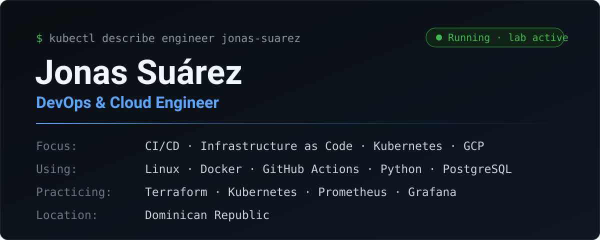

  

  
  

## About

I'm Jonas, an engineer from the Dominican Republic focused on DevOps and cloud infrastructure.
I came to operations from backend development with Python, so I care about what happens after
the code works: how a service is packaged, tested, shipped and kept healthy.

The services I build run in containers, with tests in CI and a documented way to start them.
Right now I'm going deeper into infrastructure as code, Kubernetes and Google Cloud in a
hands-on lab.

## Stack

What I use in my projects, and what I'm practicing in my lab. Being on the list means I use it,
not that I've mastered it.

| Area | I use it | I'm practicing it |
| :-- | :-- | :-- |
| Systems | Linux (Pop!_OS, Ubuntu Server), Bash, SSH, Git, Nginx | |
| Containers | Docker, Docker Compose | Kubernetes (kind), Helm, k9s |
| CI/CD | GitHub Actions, pytest | act, actionlint |
| IaC & cloud | | Terraform, TFLint, Google Cloud (Cloud Run, Artifact Registry) |
| Observability | | Prometheus, Grafana, Loki, OpenTelemetry, Jaeger |
| Security | | Trivy, Hadolint, Gitleaks, ShellCheck |
| Backend & data | Python, FastAPI, SQLAlchemy, PostgreSQL, SQLite | |
| Web | TypeScript, Next.js | |

## Featured projects

### [support-tickets-api](https://github.com/Najo24-code/support-tickets-api)

Ticket and project tracking API with authentication and CSV export.

- **Container:** Dockerfile on `python:3.11-slim`; Docker Compose with a `/health` healthcheck and a persistent volume for the database.
- **CI:** GitHub Actions runs the pytest suite on every push and pull request.
- **App:** FastAPI, SQLAlchemy, JWT authentication with bcrypt password hashing.

`Python` · `FastAPI` · `Docker` · `GitHub Actions`

### [employee-management-api](https://github.com/Najo24-code/de-gestion-de-empleados-con-turnos-y-departamentos)

Employee, shift and department management API, with a small SPA frontend.

- **Container:** same delivery setup: slim Python image, Compose healthcheck, persistent volume.
- **CI:** pytest on every push and pull request through GitHub Actions.
- **App:** multi-entity CRUD, JWT authentication, CSV export.

`Python` · `FastAPI` · `Docker` · `GitHub Actions`

### [pilotoapps-web](https://github.com/Najo24-code/pilotoapps-web)

My portfolio site, built with Next.js and deployed through a CI/CD pipeline.

- **Pipeline:** every push to `main` runs `npm ci`, lint, a production build and an asset check in GitHub Actions, then deploys to GitHub Pages.
- **Live:** [najo24-code.github.io/pilotoapps-web](https://najo24-code.github.io/pilotoapps-web)

`TypeScript` · `Next.js` · `GitHub Actions` · `GitHub Pages`

More containerized FastAPI services with the same CI setup:
[taskflow-api](https://github.com/Najo24-code/taskflow-api) ·
[expense-tracker-api](https://github.com/Najo24-code/expense-tracker-api) ·
[restaurant-booking-api](https://github.com/Najo24-code/restaurant-booking-api) ·
[hotel-booking-api](https://github.com/Najo24-code/hotel-booking-api) ·
[book-tracker-api](https://github.com/Najo24-code/book-tracker-api) ·
[crm-contacts-api](https://github.com/Najo24-code/crm-contacts-api)

## Hands-on lab

Most of my DevOps practice happens in a private workstation lab. These are labs, not production
systems. What it covers today:

- **CI:** pipelines tested locally with `act` before pushing; third-party actions pinned to commit SHAs.
- **Kubernetes:** local cluster with kind; deployments hardened with non-root users, read-only filesystems, probes and resource limits, validated with kubeconform and Trivy.
- **Observability:** Prometheus, Grafana, Loki and Jaeger (OTLP traces) behind Docker Compose profiles.
- **Infrastructure as code:** Terraform for Cloud Run and Artifact Registry, checked with TFLint and Trivy. Validated locally, not applied.
- **Security:** an isolated OWASP Juice Shop network with no route to the internet or the LAN.
- **Tooling:** CLI versions pinned with mise; image and secret scanning before anything ships.

**Next:** taking one of these APIs to Cloud Run through a full pipeline (lint, test, scan, build,
push to Artifact Registry, deploy) and packaging it as a Helm chart.

## Contact

[jonassuarez30@gmail.com](mailto:jonassuarez30@gmail.com) · [Portfolio](https://najo24-code.github.io/pilotoapps-web)
